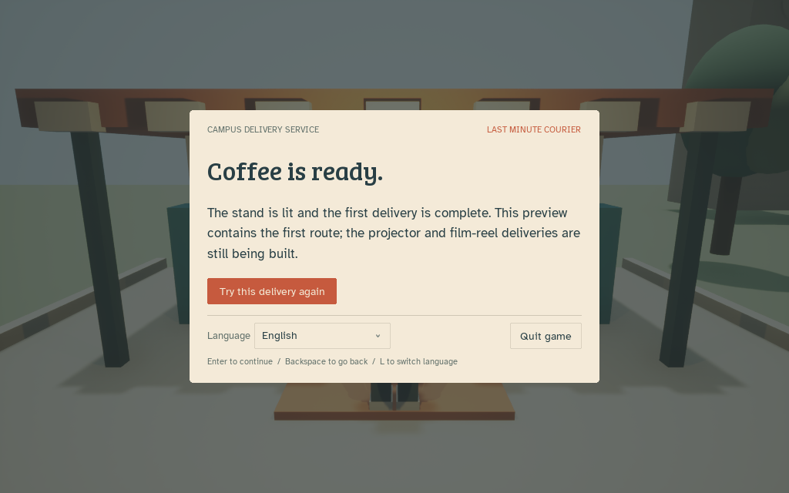

# 第一单原型完整检查 · 2026-10-29

结论：第一单已有可运行的技术闭环，本轮发现并修复了具体漏洞；整个游戏仍是原型，不能作为满足全部 rubric 的最终提交。

## 本轮修复

| 问题与触发条件 | 改动 | 证据 |
|---|---|---|
| 不跳跃，绕过台阶并走到下一个位置，也被判定学会跳跃 | 教学记录实际 Character 跳跃回调；未学会时回到教学检查点并提示 | 修复前引擎断言失败，修复后通过；实际键盘起跳后能进入减速教学 |
| 在远处按一次 Q 就能满足蓝车教学 | 需要在蓝车附近使用 Q；未体验减速便越过教学区会恢复到检查点 | 同一回归中先远处、再近处使用 Q |
| 只检查水平距离，地面下或高空也能接单/交付 | 提示与执行共用接地、水平距离和高度检查 | 地下接单、高空接单、高空交付三项：修复前失败，修复后通过 |
| 角色越界/撞车突然回去，原因不清楚 | 增加恢复原因提示；恢复时清零速度、跳跃与待处理移动；保留淡入和短暂无碰撞保护 | 状态回归；实际游玩看到了检查点提示 |
| 重试后仍显示练习区标题 | 待领取阶段单独显示 Ready for pickup | 源码与运行界面检查 |
| 菜单按钮不能通过 Tab 聚焦，缺少游戏内退出 | 按钮纳入键盘焦点；增加 Quit game | 实际 Tab 聚焦与 Space 退出，日志正常关闭 |
| 视角转偏后，方向锁定会锁住错误方向 | 暂停菜单增加 Recenter camera (C)，C 可以主动回正；暂停与锁定状态保留 | 新增引擎断言；回正固定到本原型 +X 路线，后续弯路必须更新 |
| 不同语言的名称共用当前语言字体 | 每个下拉条目使用对应的地区字体 | 英文界面展开时中日韩及拉丁名称均可见 |
| 开场描述三单，容易误以为当前预览包含全部内容 | 开场加第一单预览说明，已有成功页继续明确未完成内容 | 英文、德语实际开场检查 |
| 路标奶油色文字在浅色天空前难辨认 | 使用无光照文字材质和深色底板 | 最终图形复查见下节 |
| HUD 固定尺寸，小窗口有溢出风险 | 按 1280×800 设计尺寸向下缩放；启动脚本支持指定分辨率 | 小窗口检查见下节 |

## 如何验证，哪些结论不能外推

1. 在真实 UE 5.8.4 载入地图和原生角色，运行 `Courier.Regression.FirstOrderBoundaries`。完整原始报告保留在本机忽略目录 `Saved/QA`，去掉机器标识的摘要保存为 `QA-Evidence.json`。
2. 修复前：一套测试失败，包含五条错误断言。修复后第一次复跑：同套测试成功、零错误、零测试警告。最终版本加入锁定/暂停时镜头回正检查后再次成功，零错误、零测试警告。
3. 覆盖开场/返回/语言、教学、接单、背包、0.25 倍设备时间与正常订单计时、充能、暂停冻结、暂停期间松开 Q、越界检查点、超时、重试、交付、成功后计时停止。
4. 这些测试主动设置角色位置与移动模式，并显式调用计时更新。它们验证状态规则，**不证明真实碰撞物理、全部输入组合、帧时间、无眩晕或 5–10 分钟游戏时长**。
5. 真实图形窗口由代理用键盘操作，检查开场、语言下拉、德语排版、跳跃/减速教学、检查点提示、暂停菜单与退出。此前版本已完成第一单实际交付和重试；本轮最终版本的结果单独补记，不能把旧版本结果当成新版本全部通过。
6. 电脑操作工具仍会对鼠标点击报告 `noWindowsAvailable`，偶尔截图失败。键盘可以使用；不能把工具错误当成游戏按钮错误，也不能据此宣称鼠标操作已验证。原生截图有时只捕捉到菜单切换的遮罩帧，下一次操作后菜单完整，需真人观察确认是否可见闪烁。
7. 本轮本地化检查覆盖 54 条运行文案、六种可选语言、字体文件及授权。未经过各语言母语者校对，也未逐语言完成整条路线。
8. 日志显示项目内派生缓存有读取很慢/失败、退出时等待的情况。iCloud 文件可用性是开发运行风险，不能因此承诺当前启动速度和帧率稳定。未移动工程或改用户的 iCloud 设置。

## 最终图形复查

- 1024×640：暂停菜单完整显示镜头回正、方向锁定、滑条、操作按钮、语言与退出；游戏 HUD、提示和倒计时均在窗口内。
- 从新开场实际完成移动、跳跃和 Q 教学，E 领取包裹后出现背包和 02:20 倒计时。
- 镜头锁定后视角稳定；暂停期间 C 回正保留暂停与锁定。路标深色底板已在实际场景中显示。
- 最终版本实际经过运输车碰撞/检查点恢复，随后正常到咖啡摊按 E 完成交付；R 返回取件点，标题为 Ready for pickup，包裹隐藏，E 可重新接单。
- 真实订单在暂停前显示约 02:04；暂停数十秒处理文档后恢复显示 02:03，未按墙钟时间继续扣除。
- 再次接单后保持原地，让完整 140 秒倒计时自然耗尽，实际出现失败界面；按 R 返回可接单状态，倒计时消失、背包隐藏。

## 当前最大缺口，按制作顺序处理

| 优先级 | 缺口 | 下一步验收方式 |
|---|---|---|
| P0 | 第二、三单、移动平台与完整结局未实现 | 从开场正常输入完成三单，订单之间状态正确传递，最后电影夜确实开场 |
| P0 | 现有第一单是短直路，同类运输车重复，140 秒余量未按玩家数据平衡 | 为每单设计不同决策和能力迁移，再记录初玩者每段用时；不能靠延长路程凑时长 |
| P0 | 尚无 5–10 分钟体验及多轮真实反馈证据 | 多名首次接触玩家，无口头教学完成；分开记录读卡、挑战、失败与重试时间；改动关联 Git |
| P1 | 校园和角色仍由基本体构成，缺少音效、音乐、丰富动画和目的地导航 | 完成统一美术/音频、清楚方向与交互反馈；检查遮挡、绕路和误读 |
| P1 | 镜头舒适度、帧时间、小窗口、失焦/切换应用与完整真实输入边界未全面覆盖 | 真实设备、敏感玩家、不同窗口尺寸测试；出现眩晕立即停止并记录原因 |
| P1 | 没有可独立运行的 Mac / Windows / Linux 发行包 | 对应平台构建并在不依赖编辑器的环境解压运行，逐一验证字体、JSON、材质、输入与完整关卡 |
| P1 | 文档、课堂格式与最终玩法尚未对齐 | 完整 Game Script；按第三/四讲核对 High Concept 与适用的研究生要求；原 PDF 重新读取成功后逐项复核 |
| P1 | 发布与提交证据未完成 | GitHub 仓库及老师权限、Box 下载、Blackboard 所需报告和链接分别核实 |
| P2 | 失败标题 Almost there 偏鼓励，但没有明确写出超时原因 | 后续统一结果页时直接显示超时原因、订单用时与重试操作 |

真人试玩次数仍为 **0**。本轮是开发审查、自动化回归和代理操作检查，不冒充玩家反馈驱动迭代。

实际交付后的原生引擎截图：

## 复跑

在工程根目录先运行 `Scripts/build_editor.command`，完成后关闭图形预览，再运行 `Scripts/audit_game.command`。不要同时启动多个预览和测试抢占同一份派生缓存。图形预览使用 `Scripts/play_prototype.command`，不需要修改全局 xcode-select。
