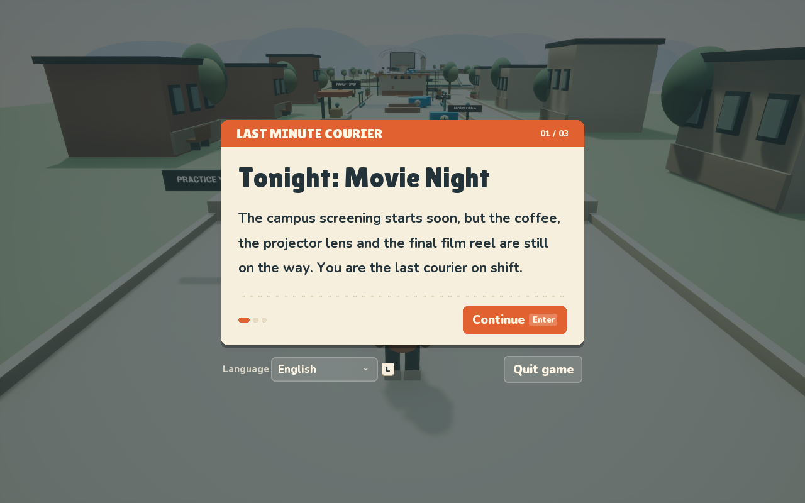
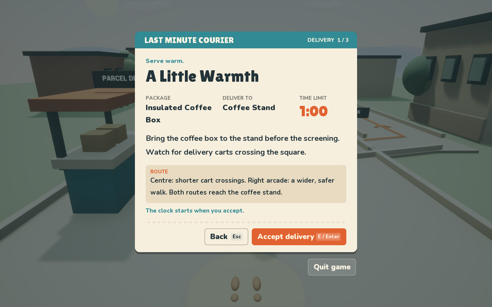
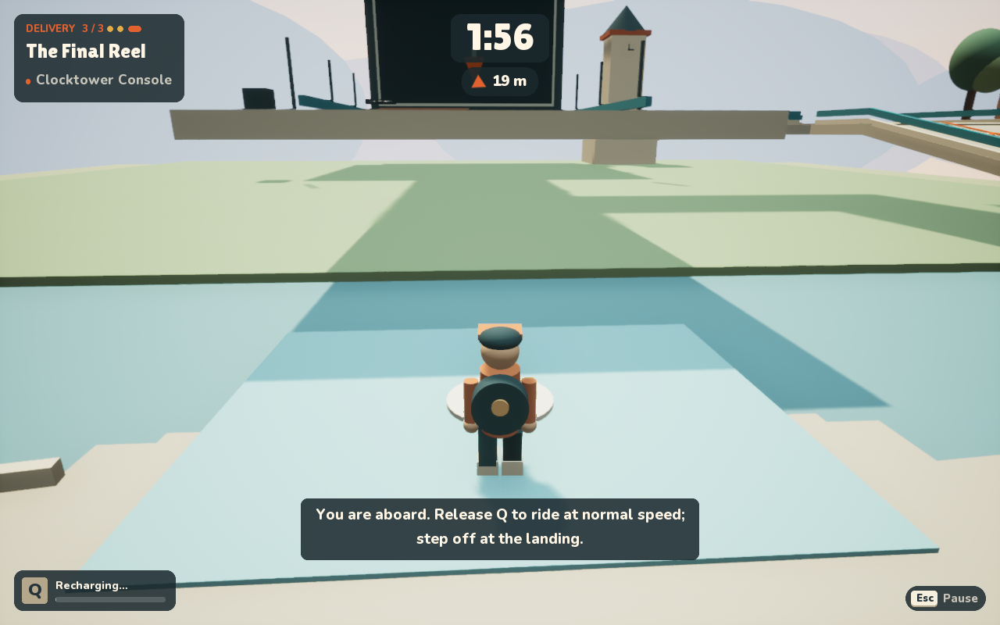
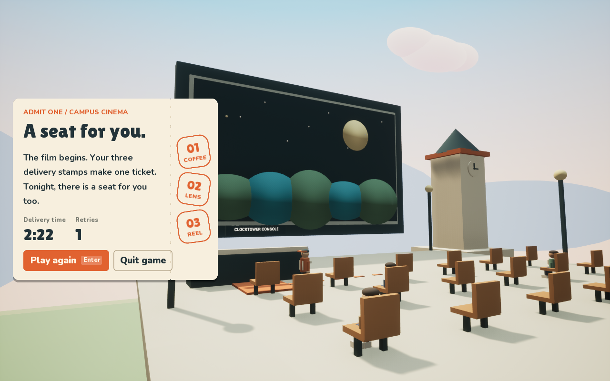

# Last Minute Courier

A 3D campus delivery game made in **Unreal Engine 5.8** for CSCI 5999B, Project 3. Theme: **Time**.

The campus movie night is about to start, but the coffee, the projector lens and the final film reel are still on the way. You are the last courier on shift. Hold **Q** to borrow a few seconds from blue clock‑tagged machinery (carts, lifts, a shuttle) and slow it to a quarter speed, while you and your delivery clock keep moving at full speed. Deliver all three parcels and earn a seat at the screening. Each parcel has its own concern: the coffee cools, the fragile lens cracks after three knocks, and the final reel must beat the screening. Borrower cells on the harder lines give Q extra uses, and every delivery is rated up to three stars.

| | |
|---|---|
|  |  |
|  |  |

## Design documents

- **High Concept:** [PDF](output/pdf/LastMinuteCourier-HighConcept.pdf) · [source](Documentation/HighConcept.md)
- **Game Script** (rules, modes, what the game teaches, player, background, iteration history, graduate mechanics and balance lenses): [PDF](output/pdf/LastMinuteCourier-GameScript-Graduate.pdf) · sources [GameScript.md](Documentation/GameScript.md), [GraduateAnalysis.md](Documentation/GraduateAnalysis.md)
- **Iteration log** (what changed between versions, why, and which playtest observation caused it): [ITERATIONS.md](Documentation/ITERATIONS.md)

## Play

Download the release for your platform (see the course Box folder; the Mac build is also attached to the GitHub release). No Unreal Editor is needed.

- **Mac:** open `LastMinuteCourier-0.8-Mac-arm64.dmg` and run `LastMinuteCourier.app` (Apple silicon). It is ad‑hoc signed, not notarized: the first time, right‑click the app and choose **Open**.
- Windows (x86-64) and Linux (x86-64) builds are made on a Windows PC with `Scripts/package_windows.bat` and `Scripts/package_linux.bat`; see [BuildOtherPlatforms.md](Documentation/BuildOtherPlatforms.md). They are published in the course Box folder.

| Key | Action |
|---|---|
| W A S D / Mouse | Move / look |
| Space | Jump |
| Q (hold) | Slow blue devices for up to 3 s; 3 / 4 / 5 uses per delivery, counted bottom-left |
| E | Walk up to a desk to open its brief; E accepts; E delivers on the orange square |
| C / H / Esc | Recenter camera / route help / pause and settings |
| R | Restart the current order (asks first) |

Walk up to the parcel desk to open your first brief; the yard gate opens once you accept. Practice and reading are untimed. Order time limits are 1:00, 2:30 and 2:40. English by default; Chinese, Japanese, Korean, Spanish, French and German are in the language menu.

## Iterations

Each version below is a git tag. The full reasoning for every change is in [ITERATIONS.md](Documentation/ITERATIONS.md) and summarised in the Game Script.

| Tag | Date | Main change and the observation behind it |
|---|---|---|
| `v0.1` | Oct 29 | Design baseline: concept, rules, onboarding plan |
| `v0.2` | Oct 29 | First playable campus preview, seven-language UI, camera comfort controls |
| `v0.3` | Oct 29 | A native regression run against the real level found five boundary faults (jump lesson could be skipped, Q lesson credited from far away, parcels collected underground or mid-air, mid-air delivery): all closed |
| `v0.4` | Oct 30 | User asked for stronger gameplay and a clearer start: three connected orders with lifts, stepping stones and a shuttle, untimed briefs, original audio, sunset sky; guardrails that blocked a ramp turn removed |
| `v0.5` | Nov 1 | User asked for play that feels logical: coffee traffic teaches one gap before two, contextual wait/Q/ride/release hints, a livelier campus. Real input found a mismatched jump prompt, a backward lesson target and misleading arrival guidance. (Committed together with the first v0.5.1 fixes.) |
| `v0.5.1` | Nov 1 | A complete ordinary-input run exposed an awning blocking the camera and side ramps losing progress; the first packaged build crashed at startup (UI read data before it loaded). All fixed |
| `v0.5.2` | Nov 4 | A short Q tap "passed" the Q lesson without learning it: lesson and lift guidance rewritten |
| `v0.5.3` | Nov 5 | Playtester: waiting for a gap and crossing felt natural but caused respawns, and the route was hard to see. Forced-Q reset removed; continuous route arrows added |
| `v0.5.4` | Nov 7–8 | Full real-speed playthrough timed out at the shuttle (a rail blocked boarding) and found a gap at the last lift: both fixed. Time limits tightened after the run left most of each clock unused. Interface redesigned and controls changed to match first instinct after the playtester found the UI generic and template-like |
| `v0.6` | Nov 8 | First first-time playtest: the player walked past the parcel desk to the coffee stand without an order, saw frozen carts, got no response from E at the counter, and the camera slid inside an NPC. Desks now open their brief on arrival, a yard gate holds until the first order is accepted, the world always moves, E always explains itself, people and props stop the camera, and Q has a visible number of uses per delivery |
| `v0.7` | Nov 8 | Owner: still less fun than commercial games. Added golden clocks (+5 s each, mostly on the risky lines), a 1–3 star rating per delivery with a total and rank at the end, a blue slow-time screen grade with lowered music pitch for Q, hit flashes, a final-ten-seconds tick and delivery confetti |
| `v0.8` | Nov 8 | Owner: monotonous, and much did not make sense. Carts became one-way traffic between depot sheds; a cart now knocks you aside instead of teleporting you; the coffee cools and the lens case cracks after three knocks, each judged by its own stars; golden clocks became Borrower cells (+1 Q use); hedges mark the edge; briefs explain who handed over each parcel. The owner also saw the orange line lead to a ramp while the marker led to a lift: only the recommended route is painted now, with arrows riding on the lifts |

## Build and test (developers)

Requires Unreal Engine 5.8 and Xcode on macOS.

```bash
./Scripts/build_editor.command '/Users/Shared/Epic Games/UE_5.8'      # compile
./Scripts/audit_game.command '/Users/Shared/Epic Games/UE_5.8' Regression   # 3 engine regression suites
./Scripts/autoplay.command                                              # real-speed playthrough with screenshots
python3 Scripts/validate_localization.py                                # 7-language coverage
```

`autoplay.command` launches the game with a QA-only autopilot that uses only player controls (move, look, jump, hold Q, E, Enter), never teleports, and writes an event log plus screenshots to `Saved/AutoPlay/`. Add `COURIER_AUTOPLAY_EXTRA=-CourierUITour` to also capture every menu in several languages. It is a lower bound for an expert who already knows the route, not a substitute for human playtesting.

## Credits

Original procedural campus built from engine basic shapes; original synthesized music and sound effects. Fonts: Lilita One, Nunito and Noto Sans CJK under the SIL Open Font License 1.1. See [ASSET_CREDITS.md](Documentation/ASSET_CREDITS.md).
